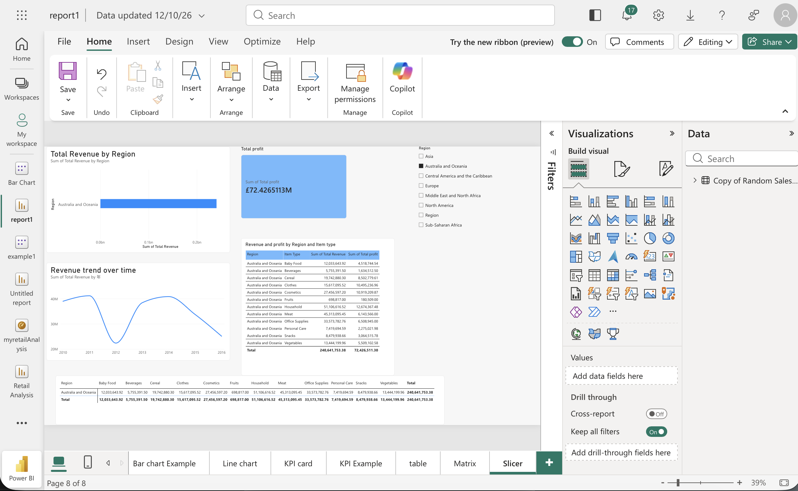

# 📊 Global Sales & Revenue Analytics Dashboard

## 📌 Project Overview
This project is an interactive Power BI dashboard created to analyze global sales metrics, region-wise revenue distribution, and profit margins.

## 📈 Dashboard Preview

## 💡 Key Features & Analysis
* **KPI Metrics:** Tracked Total Profit (£117.22M) and aggregate revenue across product categories.
* **Regional Insights:** Visualized revenue distribution across Central America, Caribbean, Europe, and other regions.
* **Trend Analysis:** Analyzed multi-year revenue trends (2010–2016) to identify performance peaks.
* **Interactive Filtering:** Implemented region slicers and product breakdown tables for quick data exploration.

## 🛠️ Tools & Technologies Used
* **Power BI Service / Desktop** (Report & Dashboard Design)
* **Data Visualizations:** Bar Chart, Line Chart, KPI Cards, Matrix, and Slicers
